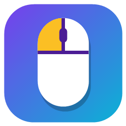

<p align="center">
  
</p>

<h1 align="center">Double Click Fix</h1>

<p align="center">
  Your mouse double clicks when you click once? This fixes it.
</p>

<p align="center">
  <b>English</b> · <a href="README.ru.md">Русский</a>
</p>

<p align="center">
  <a href="https://github.com/NaxefirYT/double-click-fix/releases/latest"></a>
  
  
  <a href="LICENSE"></a>
</p>

---

Mouse switches wear out. When they do, a single press turns into a quick burst of press/release events, so you get random double clicks, dropped drags and text selections that fall apart halfway. The usual fix is a soldering iron or a new mouse. This one is a 160 KB exe.

Double Click Fix sits in the tray and drops those ghost clicks before any app sees them.

## Features

- Filters left, right and middle buttons
- Keeps drag and drop working, a bouncing switch no longer breaks a drag mid-way
- Adjustable threshold from 20 to 100 ms
- Optional autostart with Windows
- Counter of blocked clicks, so you can see how bad your mouse is
- No installer, no runtime, no background services. One small native exe, about 2 MB of RAM

## How it works

The app installs a low-level mouse hook and holds every button release for a few milliseconds.

```
press ─── release ── press ─────────── release
            │          │
            └── < threshold: chatter, both events are dropped, the press continues

press ─── release ──────────────────── press
            │
            └── no new press within threshold: the release is sent as usual
```

A real double click has a gap of 80 ms or more between release and the next press. Switch chatter is usually under 30 ms. The default threshold of 40 ms sits between them.

The only cost is that every release arrives a little later. At 40 ms you won't notice it outside of competitive shooters.

## Install

1. Download `double-click-fix.exe` from [Releases](https://github.com/NaxefirYT/double-click-fix/releases/latest)
2. Put it somewhere permanent and run it
3. Right click the tray icon and enable autostart if you want it on every boot

The interface is in Russian. Right click the icon for the menu, double click it to turn filtering on or off. The icon turns gray when filtering is off.

| Menu item | What it does |
|---|---|
| Включено | Turn filtering on or off |
| Порог | Threshold in milliseconds |
| Автозапуск | Start with Windows |
| Отсечено ложных кликов | Number of blocked ghost clicks |
| Выход | Exit |

## Tuning

- Still getting ghost clicks: raise the threshold to 60 ms
- Your own fast double clicks stop working: lower it to 30 ms
- Windows timers tick roughly every 15 ms, so 20 ms behaves closer to 30 ms in practice

Settings are stored in `HKCU\Software\DoubleClickFix`. Autostart uses the standard `HKCU\...\CurrentVersion\Run` key.

## Notes

- Windows does not let a normal process see input sent to elevated windows. If you need the fix inside apps running as administrator, run Double Click Fix as administrator too
- Input generated by other programs (remote desktop, macros) is passed through untouched

## Building

Requires Rust and the MSVC build tools.

```
cargo build --release
```

The binary ends up in `target/release/double-click-fix.exe`.

## License

[MIT](LICENSE)
