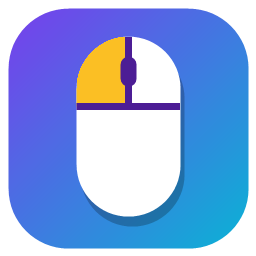

<p align="center">
  
</p>

<h1 align="center">Double Click Fix</h1>

<p align="center">
  Мышь делает двойной клик, когда жмёшь один раз? Это лечится.
</p>

<p align="center">
  <a href="README.md">English</a> · <b>Русский</b>
</p>

<p align="center">
  <a href="https://github.com/NaxefirYT/double-click-fix/releases/latest"></a>
  
  
  <a href="LICENSE"></a>
</p>

---

Микрики в мышках изнашиваются. Когда это происходит, одно нажатие превращается в быструю пачку нажатий и отпусканий: появляются случайные двойные клики, перетаскивание обрывается, выделение текста слетает на полпути. Обычно это чинят паяльником или покупкой новой мыши. Здесь хватит exe на 160 КБ.

Double Click Fix сидит в трее и выкидывает ложные клики раньше, чем их увидит хоть одна программа.

## Возможности

- Фильтрует левую, правую и среднюю кнопки
- Не ломает перетаскивание: дребезг больше не обрывает drag на середине
- Порог настраивается от 20 до 100 мс
- Автозапуск вместе с Windows
- Счётчик отсечённых кликов, чтобы видеть, насколько всё плохо с мышью
- Без установщика, рантаймов и служб. Один маленький нативный exe, около 2 МБ памяти

## Как это работает

Программа ставит низкоуровневый хук мыши и придерживает каждое отпускание кнопки на несколько миллисекунд.

```
нажатие ── отпускание ── нажатие ─────────── отпускание
               │            │
               └── меньше порога: дребезг, оба события выкидываются, нажатие продолжается

нажатие ── отпускание ────────────────────── нажатие
               │
               └── за время порога нового нажатия нет: отпускание уходит как обычно
```

У настоящего двойного клика между отпусканием и следующим нажатием проходит 80 мс и больше. Дребезг микрика обычно укладывается в 30 мс. Порог по умолчанию, 40 мс, стоит между ними.

Плата одна: отпускание кнопки приходит чуть позже. При 40 мс это заметно разве что в соревновательных шутерах.

## Установка

1. Скачай `double-click-fix.exe` из [Releases](https://github.com/NaxefirYT/double-click-fix/releases/latest)
2. Положи его в постоянное место и запусти
3. Нажми правой кнопкой по иконке в трее и включи автозапуск, если нужно

Правый клик по иконке открывает меню, двойной клик включает и выключает фильтр. Когда фильтр выключен, иконка становится серой.

| Пункт меню | Что делает |
|---|---|
| Включено | Включает и выключает фильтр |
| Порог | Порог в миллисекундах |
| Автозапуск | Запуск вместе с Windows |
| Отсечено ложных кликов | Сколько ложных кликов уже отсечено |
| Выход | Закрывает программу |

## Настройка

- Ложные клики всё равно проскакивают: подними порог до 60 мс
- Перестали работать твои собственные быстрые двойные клики: опусти до 30 мс
- Таймеры Windows тикают примерно раз в 15 мс, поэтому 20 мс на практике ведут себя ближе к 30 мс

Настройки хранятся в `HKCU\Software\DoubleClickFix`. Автозапуск использует стандартный ключ `HKCU\...\CurrentVersion\Run`.

## Нюансы

- Windows не даёт обычному процессу видеть ввод в окнах, запущенных от администратора. Если фикс нужен и там, запускай Double Click Fix тоже от администратора
- Ввод, который генерируют другие программы (удалённый рабочий стол, макросы), проходит без изменений

## Сборка

Нужны Rust и MSVC Build Tools.

```
cargo build --release
```

Готовый файл появится в `target/release/double-click-fix.exe`.

## Лицензия

[MIT](LICENSE)
